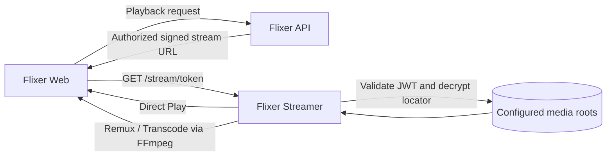

<div align="center">

# 🎬 Flixer Streamer

### Your media, your rules, beautifully streamed.

**The lightweight, high-performance streaming engine powering Flixer.**

[Flixer Backend](https://github.com/flixermedia/flixer) · [Flixer Web](https://github.com/flixermedia/flixer-web) · [Streaming Design](DESIGN.md) · [Report an Issue](https://github.com/flixermedia/flixer-streamer/issues)

</div>

---

> [!WARNING]
> **Under Active Development:** Flixer Streamer is an early-stage component of the Flixer ecosystem. Behaviour, endpoints, and configuration may change as integration evolves.

> [!NOTE]
> **Architecture:** This repository contains **only the Go media-delivery service**. User accounts, library metadata, and application APIs belong to [Flixer](https://github.com/flixermedia/flixer); the user interface lives in [Flixer Web](https://github.com/flixermedia/flixer-web). The streamer is not a standalone media-library application.

Flixer Streamer is an open-source, self-hosted media streaming service written in **Go**. It delivers files from configured media directories, validates signed playback requests, and uses **FFmpeg** to remux or transcode media when necessary—all without managing user accounts or connecting to the Flixer database.

---

## 🌟 Why Flixer Streamer?

- 🚀 **Efficient media delivery** — Go-based HTTP streaming with byte-range support for compatible files.
- 🎞️ **Intelligent playback paths** — Direct Play, Direct Stream (remux), and on-the-fly transcoding.
- 🔒 **Protected playback** — Short-lived HS256 JWTs and AES-256-GCM-encrypted media locators.
- 📁 **Multiple media roots** — Serve files from several configured local directories without trusting client-supplied paths.
- ⚙️ **FFmpeg integration** — Probe media, remux supported streams, or convert unsupported video to H.264/AAC.
- 🐳 **Container-friendly** — Multi-stage Docker image, unprivileged runtime user, and health check.
- 🧩 **Purpose-built for Flixer** — Separates media delivery from the backend API and web frontend.

---

## 🏗️ How It Works



Flixer is responsible for authorizing users and issuing playback tokens. Flixer Streamer validates those tokens, resolves the requested file securely within an allowed media root, and serves the result. The **proposed playback-info/session API** is documented in [DESIGN.md](DESIGN.md); it is not implemented by this repository.

### Playback methods

| Method | Behaviour | Typical use |
| --- | --- | --- |
| **Direct Play** | Serves a compatible original file over HTTP, including `Range` requests and `206 Partial Content`. | Compatible MP4/WebM files without seeking or resize options. |
| **Direct Stream** | Uses FFmpeg to copy compatible streams into fragmented MP4 or WebM; may convert incompatible audio. | Container remuxing (such as MKV) or time-based seeking. |
| **Transcode** | Re-encodes video to H.264 and audio to AAC in fragmented MP4. | Unsupported video codecs or a requested lower output resolution. |

Direct Stream and Transcode use a live FFmpeg output pipe rather than HTTP byte ranges. Seeking in these modes uses a new request with the `start` parameter. The streamer cancels the FFmpeg process if the client disconnects.

---

## 🚀 Getting Started

### Recommended: Run with Flixer

For a complete application, use the [main Flixer repository](https://github.com/flixermedia/flixer), whose Docker Compose stack connects the API, web app, streaming service, and reverse proxy.

```bash
git clone https://github.com/flixermedia/flixer.git
cd flixer
cp .env.example .env
# Configure DATABASE_URL, secrets, public URLs and MEDIA_PATH
docker compose up -d
```

See the [Flixer README](https://github.com/flixermedia/flixer#readme) for full stack configuration. The main stack shares `STREAM_TOKEN_SECRET` between the backend and streamer and mounts the media folder into both containers.

### Run the streamer from source

**Requirements:** Go 1.25+, FFmpeg and FFprobe (for remuxing/transcoding), and access to your local media files.

```bash
git clone https://github.com/flixermedia/flixer-streamer.git
cd flixer-streamer
cp .env.example .env
```

Configure at least `STREAM_TOKEN_SECRET` and `MEDIA_ROOTS` in `.env`, then build and run:

```bash
go build -o flixer-streamer ./cmd/flixer-streamer
./flixer-streamer
```

By default, the service listens on port **8091**. Verify that it is running:

```bash
curl http://localhost:8091/healthz
```

Expected response:

```json
{"status":"ok"}
```

> [!IMPORTANT]
> A healthy streamer does **not** mean playback URLs are immediately available. Actual media requests require a properly issued signed token from an integrated backend. Do not place the streamer on the public internet without HTTPS and appropriate routing/access protections.

### Docker image

The repository includes a multi-stage `Dockerfile` that installs FFmpeg and runs the service as an unprivileged user. To build locally:

```bash
docker build -t flixer-streamer:local .
```

For a full deployment, prefer the main Flixer Compose stack. If deploying this image independently, mount media read-only, provide the required environment variables, and make sure the running user can read the media files. Do not expose arbitrary host filesystem directories.

---

## ⚙️ Configuration

Copy `.env.example` and adjust the values to match your installation.

| Variable | Description | Example / default |
| --- | --- | --- |
| `PORT` | HTTP listen port. | `8091` |
| `STREAM_TOKEN_SECRET` | Shared token-signing secret; must match the Flixer backend and contain at least 32 random bytes. | **Required** |
| `MEDIA_ROOTS` | Ordered list of local media folders; JSON array recommended. | `["/media/movies","/media/tv"]` |
| `FFMPEG_PATH` | FFmpeg executable path. | `ffmpeg` |
| `FFPROBE_PATH` | FFprobe executable path (optional). | `ffprobe` |
| `MAX_TRANSCODES` | Maximum simultaneous FFmpeg jobs; `0` means unlimited. | `0` |
| `FFMPEG_LOG_LEVEL` | Verbosity of forwarded FFmpeg output. | `info` |
| `TRANSCODE_DIR` | Reserved for future HLS/transcoding cache use. | `./cache/transcode` |
| `ALLOWED_ORIGINS` | Optional comma-separated permitted browser origins; empty disables cross-origin browser access. | Empty |
| `LOG_LEVEL` | Service logging level. | `info` |

**Important:** Media root IDs are assigned by the order in `MEDIA_ROOTS` (`root-1`, `root-2`, etc.). Preserve this order while issued playback tokens are still valid.

---

## 🔌 HTTP API

The following routes are implemented by the streamer:

| Method | Route | Purpose |
| --- | --- | --- |
| `GET`, `HEAD` | `/stream/{token}` | Deliver authorized media via Direct Play, remuxing, or transcoding. |
| `GET` | `/info/{token}` | Inspect the planned delivery method, source details, and available output heights. |
| `GET` | `/healthz` | Liveness check. |

### Streaming options

Authorized stream requests support two optional query parameters:

| Parameter | Usage |
| --- | --- |
| `height` | Request a maximum output height: `240`, `360`, `480`, `720`, or `1080` (never upscales). |
| `start` | Start playback from a time offset in seconds. |

Example using a **token issued by Flixer**:

```http
GET /stream/{signed-token}?height=720&start=60
```

Retrieve stream information:

```http
GET /info/{signed-token}
```

Example response (illustrative):

```json
{
  "playMethod": "DirectStream",
  "source": {
    "videoCodec": "h264",
    "width": 1920,
    "height": 1080,
    "durationSeconds": 10
  },
  "availableHeights": [240, 360, 480, 720]
}
```

Invalid or expired tokens return **401**; unresolved or disallowed media returns **404**. If the configured transcode concurrency limit is reached, the service may return **503**. For the complete HTTP and token contracts, see [DESIGN.md](DESIGN.md).

---

## 🔐 Security by Design

- **Signed tokens:** Requests use HS256 JWTs, validated against the configured `STREAM_TOKEN_SECRET`.
- **Encrypted media references:** Media root IDs and relative paths are carried in an AES-256-GCM-encrypted locator, not exposed as ordinary URL paths.
- **Filesystem containment:** Paths are resolved against permitted media roots with traversal and symlink checks.
- **Short-lived access:** Tokens include expiry and must not exceed the supported four-hour maximum lifetime.
- **Private responses:** Successful media responses use private, no-store caching headers; streamer logging avoids exposing raw tokens and URLs.
- **No database credentials:** Flixer Streamer does not access the backend's database or implement user authentication itself.

Use HTTPS, a strong unique secret, read-only media mounts, and trusted administrators for media directory management. CORS restrictions are not a substitute for authentication.

---

## 🗺️ Development Roadmap

| Feature | Status |
| --- | --- |
| JWT validation and encrypted media locations | ✅ Implemented |
| Multiple local media roots | ✅ Implemented |
| Progressive HTTP streaming and byte ranges | ✅ Implemented |
| FFmpeg remuxing and live transcoding | ✅ Implemented |
| Stream info and health endpoints | ✅ Implemented |
| HLS playlists, segments, and adaptive bitrate | 🕒 Planned |
| Integration with Flixer playback-info and sessions | 🕒 Backend work pending |
| More advanced hardware acceleration and additional storage backends | 💡 Future possibilities |

See [DESIGN.md](DESIGN.md) for implementation details, protocol design, and proposed integration contracts. Roadmap items describe intentions rather than shipped functionality.

---

## 🧩 Flixer Ecosystem

| Repository | Role |
| --- | --- |
| [**flixermedia/flixer**](https://github.com/flixermedia/flixer) | Core API, user authentication, settings, and backend services. |
| [**flixermedia/flixer-web**](https://github.com/flixermedia/flixer-web) | Vue-powered frontend and playback user interface. |
| [**flixermedia/flixer-streamer**](https://github.com/flixermedia/flixer-streamer) | Go-based media delivery, remuxing, and transcoding (**this repository**). |

---

## 🤝 Contributing

Contributions, bug reports, and ideas are welcome. Please [open an issue](https://github.com/flixermedia/flixer-streamer/issues) to discuss bugs or enhancements, and submit a pull request with a focused description of your changes. For protocol and architectural changes, review [DESIGN.md](DESIGN.md) first.

---

<div align="center">

**Your media. Your server. Your rules.**

Made for the [Flixer](https://github.com/flixermedia/flixer) ecosystem.

</div>
